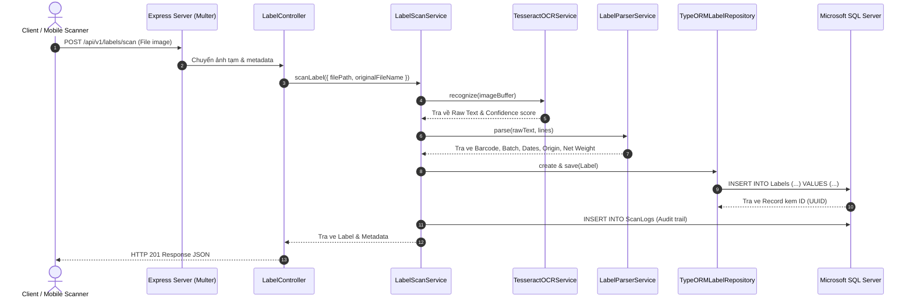

# Kiến trúc Hệ thống (System Architecture & Archify Design)

Tài liệu này mô tả chi tiết thiết kế kiến trúc của dự án **AI Label OCR**, tuân thủ nguyên tắc **Clean Architecture** (Kiến trúc phân tầng sạch) kết hợp **Repository Pattern** và mô hình hóa trực quan bằng **Archify**.

---

## 1. Nguyên tắc thiết kế (Design Principles)

1. **Độc lập tầng Core (Domain-Driven & Clean Architecture)**:
   - Tầng `Domain` không phụ thuộc vào bất kỳ framework bên ngoài nào (ngoại trừ decorator TypeORM được ánh xạ linh hoạt).
   - Tầng `Application` chứa toàn bộ luồng nghiệp vụ xử lý tem nhãn, gọi trừu tượng thông qua `ILabelRepository` và `IScanLogRepository`.
   - Tầng `Infrastructure` đảm nhận việc tích hợp công nghệ cụ thể: Microsoft SQL Server (`mssql`), Tesseract.js OCR, hệ thống file Multer, và công cụ Archify.
   - Tầng `Interfaces` phụ trách expose API (Express RESTful Controller).

2. **Repository Pattern**:
   - `ILabelRepository`: Định nghĩa hợp đồng nghiệp vụ cho việc lưu trữ, tìm kiếm theo barcode, mã lô (batch), phân trang, lọc theo ngày và cập nhật thông tin nhãn.
   - `TypeORMLabelRepository`: Cài đặt cụ thể interface trên bằng TypeORM dành cho Microsoft SQL Server.
   - Cho phép dễ dàng chuyển đổi database hoặc tạo Mock Repository trong Unit Test mà không cần thay đổi nghiệp vụ.

3. **Mô hình hóa với Archify**:
   - Tích hợp tài liệu JSON Intermediate Representation (`src/infrastructure/archify/archify.json`).
   - Tự động sinh giao diện sơ đồ kiến trúc động chuẩn web (`docs/architecture-diagram.html`).

---

## 2. Sơ đồ các tầng kiến trúc

```text
+---------------------------------------------------------------------------------+
|                               Presentation Layer                                |
|  - Express HTTP Server                                                          |
|  - LabelController (Upload, CRUD, Query)                                        |
|  - Multer Image Middleware & Error Handler                                      |
+---------------------------------------------------------------------------------+
                                       |
                                       v
+---------------------------------------------------------------------------------+
|                                Application Layer                                |
|  - LabelScanService (Orchestrator)                                              |
|  - DTOs & Zod Validation Schemas                                                |
+---------------------------------------------------------------------------------+
                                       |
                   +-------------------+-------------------+
                   |                                       |
                   v                                       v
+---------------------------------------+  +--------------------------------------+
|             Domain Layer              |  |         Infrastructure Layer         |
|  - Entities: Label, ScanLog           |  |  - TesseractOCRService (Local OCR)   |
|  - Repository Interfaces:             |  |  - LabelParserService (Regex Engine) |
|    * ILabelRepository                 |  |  - TypeORMLabelRepository (MSSQL)    |
|    * IScanLogRepository               |  |  - TypeORMScanLogRepository (MSSQL)  |
|  - Value Objects: LabelParsedData     |  |  - Archify Diagram Generator         |
+---------------------------------------+  +--------------------------------------+
                                                               |
                                                               v
                                           +--------------------------------------+
                                           |        Microsoft SQL Server          |
                                           |  - Tables: Labels, ScanLogs          |
                                           |  - Nonclustered Indexes              |
                                           +--------------------------------------+
```

---

## 3. Quy trình xử lý khi Scan một Label (End-to-End Workflow)



---

## 4. Tích hợp Archify

Dự án có module chuyên biệt tại `src/infrastructure/archify`:
- **`archify.json`**: Cấu trúc khai báo định tuyến (layers, components, technology stack, data flow).
- **`generate-diagram.ts`**: Biên dịch sơ đồ tương tác thành giao diện HTML độc lập tại `docs/architecture-diagram.html`.
- Bạn có thể chạy lệnh sau bất kỳ lúc nào để cập nhật sơ đồ:
  ```bash
  npm run archify:generate
  ```

